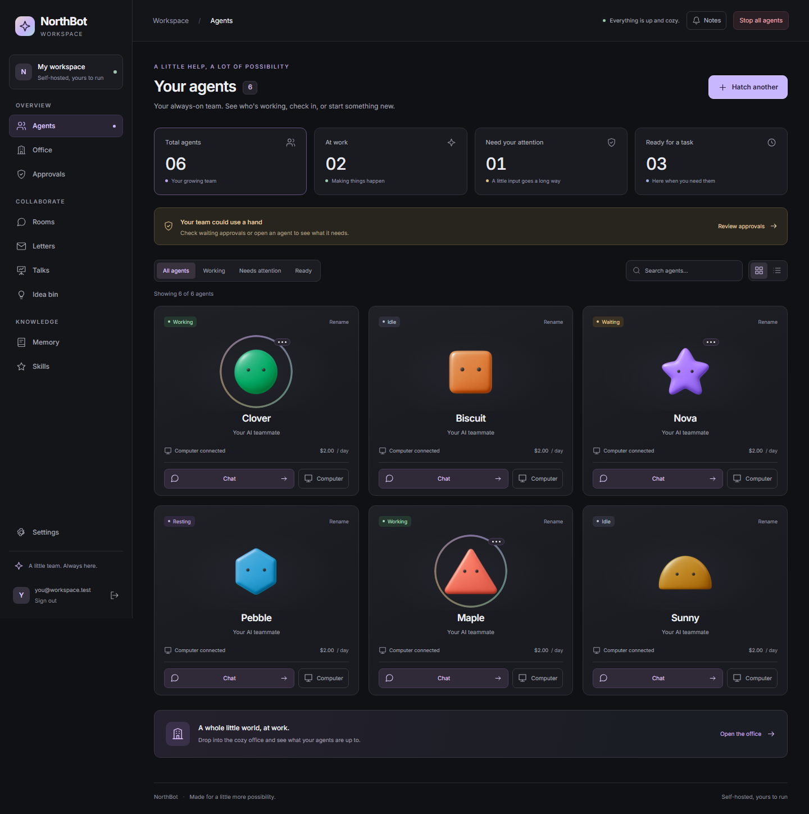

# NorthBot

An open, self-hostable platform of always-on AI agents. Each agent has its own cloud computer (a terminal and a browser), agents talk to each other in rooms, letters and Talks, and you watch them in a cozy 2.5D office.

> Work in progress. See `STATUS.md` for which milestones are done.

## In the workspace

- **Agents:** see who is working, who needs help, and who is ready. Search your team, filter by status, and switch between grid and list views.
- **Chat and computers:** explore an idea with Ask, start a task with Do it, attach files, or inspect an agent's terminal and browser.
- **Collaboration:** bring agents together in rooms, route requests through letters, discuss decisions in Talks, and save ideas for later.
- **Memory and skills:** inspect what the team remembers and review reusable routines before approving them.
- **The office:** watch an event-driven, animated pixel office, or use its accessible list view.
- **Your controls:** review approvals, manage rules and budgets, set quiet hours, and stop all agents when needed.

The responsive dark UI supports English, Brazilian Portuguese, Spanish, keyboard navigation and reduced motion. Agent portraits use ten original high-definition Higgsfield mascots, retaining the existing 150 shape-and-colour identities. Original PNGs, optimized WebP assets and generation prompts are in `apps/web/public/avatars`.



Read the [project review](docs/PROJECT_REVIEW.md) for architecture, implementation status and the UI refresh details. See `STATUS.md` for milestone completion and remaining work.

## Quickstart (local)

Needs Docker, Node 22+ and pnpm 9.

```bash
pnpm install
docker compose --profile images build agent-image   # the agent computer image (first build takes a while)
docker compose up -d --build
```

- Web app: http://localhost:8080
- API: http://localhost:3000 (health at `/health`, OpenAPI at `/openapi.json`)

## Development

```bash
pnpm test             # unit tests (needs the compose Postgres running)
pnpm lint
pnpm typecheck
pnpm acceptance:all   # every milestone acceptance script
```

For frontend development against the running local API:

```bash
pnpm --filter @northbot/web dev
pnpm --filter @northbot/web exec playwright install chromium  # first time
pnpm --filter @northbot/web exec playwright test workspace-ui.spec.ts
```

The browser suite defaults to the built app at `http://localhost:8080`. Set `NORTHBOT_WEB=http://localhost:5173` to test the development server. Its workspace UI tests use isolated fixtures; the hatching and office acceptance tests use the running backend.

## Layout

| Path                  | What                                                              |
| --------------------- | ----------------------------------------------------------------- |
| `apps/server`         | API, WebSocket, agent runtime, scheduler worker                   |
| `apps/web`            | React app, chat UI, Cozy Office                                   |
| `packages/shared`     | zod types and the event schema                                    |
| `packages/llm-router` | model providers, aliases, fallback, redaction, pricing            |
| `packages/sandbox`    | agent computers: the `Sandbox` interface, Docker and fake drivers |
| `docker/agent`        | the agent computer image and `agentd` (shells + browser)          |
| `docker/egress`       | the egress proxy that logs every outbound connection              |
| `scripts/acceptance`  | one `mN.sh` per milestone                                         |
| `docker/`             | Dockerfiles and nginx config                                      |

## Scheduled routines

Schedules supports five-field cron (`@daily` and `@hourly` included), one-time runs and intervals. Choose an agent or room, preview the next five times in its timezone, then confirm. The default minimum interval is five minutes (`SCHEDULE_MIN_INTERVAL_S`); frequent schedules show a monthly budget estimate. In an agent chat, use **Do it** with `schedule: every weekday at 9am | Summarize invoices` to create a paused routine for review.

Run now, dry run, pause, duplicate, edit and YAML import/export are available from Schedules. History links to each task, computer and event trail. Changes to a prompt or approved skill invalidate first-run approval. Tool permissions still apply to every action. Concurrent workers claim occurrences in Postgres and deliver them through pg-boss; persisted idempotency keys prevent duplicate tasks. Catch-up, overlap, jitter, retry, runtime and daily budget limits are configurable per routine.

System routines are visible and pausable. The nightly backup routine starts paused until the deployment backup runner is configured; enabling it prematurely produces an explicit failure. Other built-ins cover health, ideas, expiring memory, costs and skill usage.


## MCP connections

Open **Settings → Tool connections** to add a server. For stdio, install the program inside the selected agent computer, enter its executable and JSON argument array, inspect the tools, then approve the displayed version. The process runs as the unprivileged `agent` user inside that container. HTTP connections support a bearer token referenced by vault name; token values are never returned by the connection API. Each agent has an independent tool review and per-tool allow/ask/block, action classification and declared cost. Description, schema or version changes stop calls until a human reviews again. The [server directory](packages/mcp/directory.json) provides starting points.

NorthBot's MCP endpoint is `POST /mcp` (through the web proxy, `/api/mcp`). Create a token in Settings with only the required scopes. Available tools: `send_letter`, `ask_agent`, `list_tasks`, `create_task`, `read_memory`, `list_schedules`, `create_schedule`. Tokens are workspace-scoped, revocable, hashed in storage and limited to 60 requests/minute. Tool scopes are shown in the token form; `mcp:tasks:write` cannot read memory. Tasks retain the ordinary permission checks and kill switch; MCP-created schedules require first-run approval.

For an SDK client, use `Client` and `StreamableHTTPClientTransport` from `@modelcontextprotocol/sdk`, set the endpoint URL and `requestInit.headers.Authorization` to `Bearer <your token>`. Use HTTPS outside local development. OAuth has a provider interface and an explicitly test-only PKCE/state fake at `/mcp/oauth/fake/start` and `/finish`; real provider registration remains deployment-specific. Existing provider tokens can be stored in the vault and used immediately.

## Security and trust

**Security** shows checks for encryption, HTTPS, the vault key and expiring grants, along with outgoing connections, alerts and human handoffs. Resource labels are `public`, `private` or `secret`. Secret resources require explicit destinations; delivering a restricted file or memory to an agent also restricts that agent's outgoing traffic and model use. The egress proxy checks destinations on every connection. Sensitive agents use local model providers; change a label only after reviewing its data.

Passkey enrollment uses `POST /security/passkeys` with the site's public registration challenge, user handle, exact origin and relying-party hostname, while the agent browser is on that site. It returns a public WebAuthn registration response for the site to verify. Connect the credential from Security (or `/security/passkeys/:id/connect`); subsequent `navigator.credentials.get` requests go through the vault bridge, M4 login permissions and the approval inbox. Only public challenges and signed assertions reach the browser. The private key stays encrypted in the vault. The initial agent grant expires after 24 hours; owners can renew or revoke it. Passkeys currently require the relying-party ID to equal the origin's hostname.

Grant owners may manage access; users may use granted resources; use-only grants cannot manage access. Non-owner grants require expiry. Revocation is checked again on each signature, token resolution or secret injection. Previously issued third-party tokens must also be revoked at their provider. For login, 2FA or CAPTCHA, agents can request a handoff; use the computer's live view and finish the handoff in Security to resume the same task.

Memory text is encrypted under separate agent/shared keys derived from `NORTHBOT_MASTER_KEY`; search vectors remain available to Postgres. To encrypt **new persistent home volumes**, set `SANDBOX_DISK_ENCRYPTION=true` and recreate the server. The gocryptfs driver needs `/dev/fuse`, adds `SYS_ADMIN` to the root control process and uses an unconfined AppArmor profile for FUSE mounting. Agent shells still run unprivileged. Its passphrase crosses a root-only pipe into a temporary RAM file, which is removed after mounting. Existing computers keep their original storage format. Encrypted disks use deployment volume backups or encrypted disk exports, rather than image snapshots. Keep the original master key and agent identity when restoring.

Signed audit exports use Ed25519; keep the exported public key fingerprint to verify later artifacts. Activity records retain redacted summaries and exclude raw screenshots. The person-data tools export matching live records and erase matches in memory, conversations, tasks, collaboration records, routines and activity history. Backups and copies already downloaded require their own retention/deletion process.

## Change record — 2026-10-18

This record covers the UI/avatar refresh and the M8–M11 work, compared with commit `2f493ae` (the previous M8 work-in-progress checkpoint). M6 memory/skills and M7 collaboration already existed and were revalidated; they are not presented as newly added here. M12 deployment, Windows companion and the store-operator pack have **not been implemented in this work yet**.

### Added

| Area | Additions |
| --- | --- |
| Avatar artwork | Ten original Higgsfield portraits at 2048 × 2048 with transparent backgrounds: capsule, circle, diamond, hexagon, octagon, pentagon, semicircle, square, star and triangle. Each has an original PNG and an optimized WebP; `generation.json` records prompts and provenance. |
| Workspace UI | Grouped responsive sidebar, mobile navigation, shared icons, loading/error/empty states, team status counts, search, status filters, grid/list views and consistent page surfaces. |
| Chat | Multiline composer, attachment removal, keyboard submission, failed-send draft recovery, duplicate-send protection and improved streaming/scroll behavior. |
| Office acceptance | A dedicated M8 acceptance script and browser coverage for office interactions and event-derived canvas/list parity. |
| Scheduler package | Croner-based five-field cron, aliases, intervals and one-off times; timezone/DST handling; natural-language timing previews; next-five-run confirmation; frequency and monthly-budget estimates; portable YAML definitions. |
| Scheduler execution | Persistent schedule/run tables, locked occurrence claims, pg-boss delivery, stable idempotency keys, retries/backoff, catch-up limits, overlap policies, jitter, runtime limits, budget reservations, computer wake-up and first-run approval invalidation. |
| Scheduler controls | Schedules page, REST endpoints, chat proposals and an agent proposal tool; pause/resume, run now, dry run, edit, duplicate, delete, YAML import/export and task/event-linked history. System routines cover health, ideas, memory expiry, costs, skill usage and a paused backup placeholder. |
| Office scheduling | Event-derived clock, wall calendar, upcoming-run indicators, wake/stretch behavior and worried mood after repeated schedule failures. |
| MCP package | Official SDK client, Docker stdio transport, Streamable HTTP connections, a server directory, schema/version hashes and a PKCE/state-bound fake OAuth provider. |
| MCP permissions | Per-agent assignments; per-tool allow/ask/block, action kind and declared cost; description scanning; schema-change re-approval; call audit events and budget checks. |
| MCP access | NorthBot endpoint with seven tools, workspace-scoped revocable tokens, scope checks, origin checks and per-token rate limits. Settings includes connection setup, tool/schema review, policy controls and token creation/revocation. |
| Security work in progress | Agent passkeys stored in the vault, a browser signing bridge, WebAuthn assertions, temporary grants and revocation checks, human login/2FA/CAPTCHA handoffs, resource labels, destination checks, canary tokens and alerts. |
| Encryption work in progress | Agent/shared memory encryption and legacy-record conversion; optional gocryptfs encryption for new persistent home volumes; root-only RAM key handoff; restart/unlock support and encrypted disk exports. |
| Audit/privacy work in progress | Ed25519-signed audit exports, redacted activity summaries, person-data matching/export/erasure and a Security page with protection checks, grants, passkeys, handoffs, labels, canaries, alerts and outgoing connections. |
| Documentation and tests | Project review, workspace/schedule screenshots, feature/configuration instructions, migration snapshots, scheduler/MCP/security tests and acceptance scripts. New UI text is supplied in English, Brazilian Portuguese and Spanish. |

### Changed

| Area | Changes to existing behavior |
| --- | --- |
| Agent portraits | Web screens use the generated artwork while preserving all 150 shape/colour identities, uniqueness rules, mood/status indications, accessible descriptions and SVG error fallback. The office retains animated pixel sprites. |
| Navigation and screens | Existing agent, approval, chat, login, room, letter, Talk, idea, memory, skill and settings screens share clearer spacing, controls, focus styles and recovery states. Office and computer screens load on demand. |
| Office lifecycle | Pixi cleanup waits for renderer initialization before accessing its canvas, fixing a startup/unmount race. |
| Office event tests | Snapshot parity waits for the complete event-ID set because database sequence IDs may commit out of order. Test-created computers are cleaned up. Existing assertions were retained. |
| Task runtime | Extra tool providers can resolve asynchronously for MCP assignments. Scheduled retries resume the existing task checkpoint and action ledger. |
| Application startup | Registers the scheduler, MCP and security services/routes; starts the durable scheduling worker; closes service-owned resources during shutdown. |
| Database | Adds migrations `0011`–`0015`: schedules, runs, budget reservations, MCP servers/assignments, security/grant/passkey/label/canary/handoff/recording tables and encrypted-disk metadata. |
| Memory | Stores authenticated ciphertext instead of plaintext text; search, exports, imports, updates and context generation decode through the memory service. Search vectors remain queryable. Idea-bin triggers use decoded memory with the idea agent's visibility. |
| Data flow | Restricted files and memories propagate restrictions to their receiving agent. Commands, browser destinations, model calls, MCP calls and the egress proxy check the applicable restrictions. |
| Vault | Signing keys are reserved for the vault signer. They cannot be injected into a sandbox or resolved as ordinary model/MCP tokens. Grant checks apply to restricted secret use, token resolution and metadata access. |
| Agent image | Includes gocryptfs/FUSE support and a startup wrapper. Encrypted mode mounts the home before starting agentd; normal computers keep their existing storage configuration. |
| Configuration | Adds `SCHEDULE_MIN_INTERVAL_S` and `SANDBOX_DISK_ENCRYPTION` to configuration examples and Compose settings. The dependency lockfile and relevant package manifests include the new scheduler/MCP/security dependencies. |
| Shared events | Adds schedule, MCP and security event payloads, scheduled office projection state, failure mood behavior and a blocked egress status. |

### Removed or replaced

- Replaced the ad-hoc idea-bin timer in server startup with the visible weekly system schedule. The legacy configuration field remains for compatibility.
- Replaced web portrait rendering at its call sites with generated assets; the SVG fallback and animated office sprite system remain available.
- Replaced eager office/computer page imports with on-demand loading.
- Replaced direct plaintext memory-text reads in the affected services with encryption-aware access; existing memory records are converted at startup.
- Removed ordinary credential-resolution access to reserved passkey/audit signing keys.
- Replaced the old README statement that scheduling and MCP were only planned with implemented feature instructions and explicit remaining-work status.
- **No tracked project files were deleted** in this change range. “Replaced” above describes behavior or code paths, not deletion of the retained fallback assets or existing tests. Temporary editing helpers are not project deliverables.

### Validation and completion status

| Work | Verified status |
| --- | --- |
| M6–M7 | Existing acceptance scenarios were rerun successfully. |
| M8/UI | Committed as `3924d97`; M8 acceptance, 277 workspace tests, lint and type checks passed at completion. |
| M9 | Committed as `cbfe22a`; M9 acceptance, 292 workspace tests, lint and type checks passed at completion. |
| M10 | Committed as `f2965b4`; M10 acceptance, 297 workspace tests, lint and type checks passed at completion. |
| M11 | Implemented in the working tree, not yet committed or marked complete. Eight security integration tests passed, including real Chromium vault signing and an encrypted Docker home surviving restart. The latest full workspace run passed 305 tests (98 server tests). Final acceptance/browser checks and verification of subsequent edits are still pending. |
| M12 | Not started. The deployment backup runner is not connected, so the nightly backup schedule remains paused. |

Real third-party OAuth registration remains a deployment-specific integration described in `BLOCKERS.md`. The security/storage limitations and configuration requirements are documented in the Security and trust section above. This change record does not mark unfinished milestones complete.

### Complete file inventory

Compared with `2f493ae`, including current uncommitted files: **85 added, 63 modified, 0 deleted**. `*` marks a file with uncommitted changes at the time this record was written. Generated migration snapshots and binary artwork are included.

<details>
<summary>All added, modified and deleted paths</summary>

```text
ADDED
    apps/server/drizzle/0011_groovy_phalanx.sql
    apps/server/drizzle/0012_tired_sheva_callister.sql
    apps/server/drizzle/0013_furry_slapstick.sql
  * apps/server/drizzle/0014_bumpy_richard_fisk.sql
  * apps/server/drizzle/0015_material_terror.sql
    apps/server/drizzle/meta/0011_snapshot.json
    apps/server/drizzle/meta/0012_snapshot.json
    apps/server/drizzle/meta/0013_snapshot.json
  * apps/server/drizzle/meta/0014_snapshot.json
  * apps/server/drizzle/meta/0015_snapshot.json
    apps/server/src/mcp/routes.ts
  * apps/server/src/mcp/server.ts
  * apps/server/src/mcp/service.ts
    apps/server/src/schedules/execution.ts
    apps/server/src/schedules/queue.ts
    apps/server/src/schedules/routes.ts
    apps/server/src/schedules/service.ts
    apps/server/src/security/audit.ts
    apps/server/src/security/cipher.ts
    apps/server/src/security/data.ts
    apps/server/src/security/grants.ts
    apps/server/src/security/handoffs.ts
    apps/server/src/security/passkeys.ts
    apps/server/src/security/person.ts
    apps/server/src/security/routes.ts
    apps/server/test/m10.test.ts
  * apps/server/test/m11.test.ts
    apps/server/test/m9.test.ts
    apps/web/e2e/connections.spec.ts
    apps/web/e2e/schedules.spec.ts
  * apps/web/e2e/security.spec.ts
    apps/web/e2e/workspace-ui.spec.ts
    apps/web/public/avatars/capsule.png
    apps/web/public/avatars/capsule.webp
    apps/web/public/avatars/circle.png
    apps/web/public/avatars/circle.webp
    apps/web/public/avatars/diamond.png
    apps/web/public/avatars/diamond.webp
    apps/web/public/avatars/generation.json
    apps/web/public/avatars/hexagon.png
    apps/web/public/avatars/hexagon.webp
    apps/web/public/avatars/octagon.png
    apps/web/public/avatars/octagon.webp
    apps/web/public/avatars/pentagon.png
    apps/web/public/avatars/pentagon.webp
    apps/web/public/avatars/semicircle.png
    apps/web/public/avatars/semicircle.webp
    apps/web/public/avatars/square.png
    apps/web/public/avatars/square.webp
    apps/web/public/avatars/star.png
    apps/web/public/avatars/star.webp
    apps/web/public/avatars/triangle.png
    apps/web/public/avatars/triangle.webp
    apps/web/public/mcp-directory.json
  * apps/web/src/components/Icon.tsx
    apps/web/src/components/PageState.tsx
    apps/web/src/components/portrait.ts
    apps/web/src/i18n/connections.ts
    apps/web/src/i18n/schedules.ts
  * apps/web/src/i18n/security.ts
    apps/web/src/i18n/ui.ts
    apps/web/src/pages/Connections.tsx
    apps/web/src/pages/Schedules.tsx
  * apps/web/src/pages/Security.tsx
    apps/web/src/workspace.css
  * docker/agent/agentd/boot.mjs
  * docker/agent/agentd/vault-shim.mjs
    docs/PROJECT_REVIEW.md
    docs/screenshots/schedules.png
    docs/screenshots/workspace.png
    packages/mcp/directory.json
    packages/mcp/package.json
    packages/mcp/src/index.ts
    packages/mcp/src/stdio.ts
    packages/mcp/test/mcp.test.ts
    packages/mcp/tsconfig.json
    packages/scheduler/package.json
    packages/scheduler/src/index.ts
    packages/scheduler/test/scheduler.test.ts
    packages/scheduler/tsconfig.json
    packages/shared/src/office-schedules.test.ts
    scripts/acceptance/m10.sh
  * scripts/acceptance/m11.sh
    scripts/acceptance/m8.sh
    scripts/acceptance/m9.sh

MODIFIED
  * .env.example
    BLOCKERS.md
  * DECISIONS.md
  * README.md
    STATUS.md
  * apps/server/drizzle/meta/_journal.json
  * apps/server/package.json
    apps/server/src/apikeys/routes.ts
  * apps/server/src/app.ts
  * apps/server/src/auth/soft/authenticator.ts
  * apps/server/src/chat/routes.ts
  * apps/server/src/computer/manager.ts
  * apps/server/src/config.ts
  * apps/server/src/db/schema.ts
  * apps/server/src/ideas/service.ts
  * apps/server/src/letters/service.ts
  * apps/server/src/llm/service.ts
    apps/server/src/main.ts
  * apps/server/src/memory/service.ts
  * apps/server/src/services.ts
    apps/server/src/tasks/service.ts
  * apps/server/src/vault/crypto.ts
  * apps/server/src/vault/routes.ts
  * apps/server/src/vault/vault.ts
    apps/web/e2e/office.spec.ts
    apps/web/index.html
    apps/web/package.json
  * apps/web/src/App.tsx
    apps/web/src/components/AgentAvatar.tsx
    apps/web/src/components/KillSwitch.tsx
    apps/web/src/components/LookPicker.tsx
    apps/web/src/components/Notifications.tsx
  * apps/web/src/i18n/en.ts
  * apps/web/src/i18n/es.ts
  * apps/web/src/i18n/pt-BR.ts
    apps/web/src/main.tsx
    apps/web/src/office/scene.ts
    apps/web/src/pages/Agents.tsx
    apps/web/src/pages/Approvals.tsx
    apps/web/src/pages/Chat.tsx
    apps/web/src/pages/Ideas.tsx
    apps/web/src/pages/Letters.tsx
    apps/web/src/pages/Login.tsx
    apps/web/src/pages/Memory.tsx
    apps/web/src/pages/Office.tsx
    apps/web/src/pages/Rooms.tsx
    apps/web/src/pages/Settings.tsx
    apps/web/src/pages/Skills.tsx
    apps/web/src/pages/Talks.tsx
  * apps/web/src/store/session.ts
    apps/web/tailwind.config.js
  * docker-compose.yml
  * docker/agent/Dockerfile
  * docker/agent/agentd/agentd.mjs
  * docker/egress/proxy.mjs
  * packages/sandbox/src/docker.ts
  * packages/sandbox/src/sessions.ts
  * packages/sandbox/src/types.ts
    packages/shared/src/__snapshots__/office.test.ts.snap
  * packages/shared/src/events.ts
    packages/shared/src/mood.ts
    packages/shared/src/office.ts
  * pnpm-lock.yaml

DELETED
    None

```

</details>
