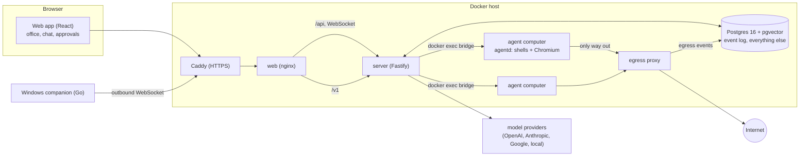
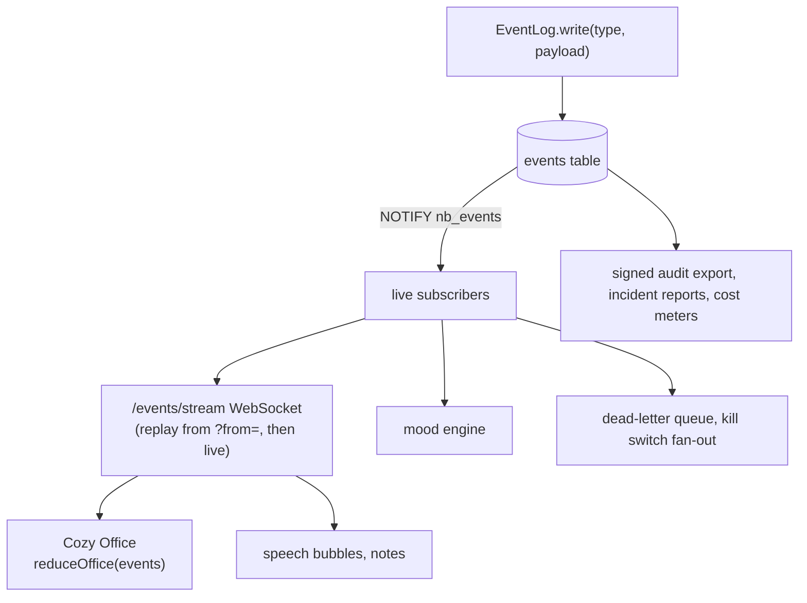
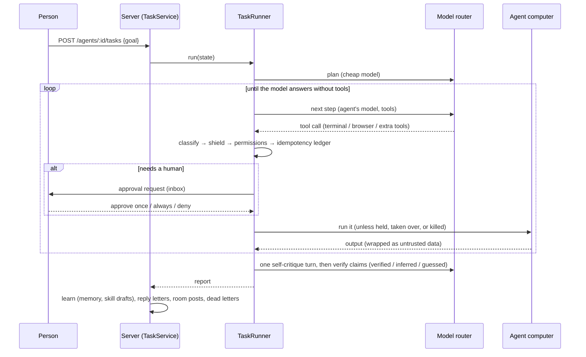

# NorthBot architecture

NorthBot runs a team of AI agents. Each agent has its own computer (a Docker container with a terminal and a browser), a model policy, a daily budget, memory, skills and permission rules. People watch and steer them through a web app; agents work through tasks, rooms, letters, Talks and routines.

## The pieces



- **web** serves the React app and proxies `/api` (REST + WebSockets) and `/v1` (the OpenAI-compatible endpoint) to the server.
- **server** is one Fastify process: auth, the vault, the model router, task runners, the scheduler worker (pg-boss), MCP, security services, the companion hub and operations.
- **agent computers** are containers on their own internal networks. The server never needs their IPs: it talks to `agentd` through `docker exec` (JSON lines over a bridge). Their only route out is the egress proxy, which checks each destination and writes an `egress` event.
- **Postgres** holds the event log (the source of truth) and all state. `NOTIFY` delivers new events to the server, which streams them to browsers.

## The event log

Every action, message, letter, tool call, mood change, approval and routine run writes an event (`packages/shared/src/events.ts` lists every type and its payload schema). Views are built from it:



Ids come from a sequence, so two writes can commit out of order: the stream sends every event exactly once, and clients place late ones by id (the office then re-reduces). The office scene is a pure function of the log (`packages/shared/src/office.ts`), which is why the canvas, the list view and the tests agree.

## A task, end to end



- **Classification** (`packages/agent-runtime/src/classify.ts`) turns each action into read / write / delete / send / spend / login.
- **Permissions**: block rules beat allow rules beat ask rules; the agent's autonomy level decides the rest.
- **The injection shield** wraps tool output as untrusted data, blocks outbound actions the goal never asked for, and taints a task that saw instructions in a page (outbound actions then need a human). Work handed over by another agent starts tainted.
- **The ledger** gives every non-read action an idempotency key, so a resumed task never repeats a write.
- **The kill switch** aborts runners within about a second, stops paired companions, and refuses new work until released.

## Models

`packages/llm-router` speaks to OpenAI, Anthropic, Google and local providers through their official SDKs, plus a scripted fake used by every test. Aliases (`northbot-smart`, `northbot-fast`) fall back across providers; personal data is redacted for cloud providers and restored in replies; budgets are enforced per workspace, API key, agent and task from the `llm.call` events. Sensitive agents use local providers only.

## Trust and security (M11)

- **Vault**: libsodium secretbox with per-workspace subkeys of `NORTHBOT_MASTER_KEY`. Values are never returned by the API; they reach a computer only as an environment variable or file at the moment of use, through grants that can expire and be revoked.
- **Agent passkeys**: the private key stays in the vault. The agent's browser asks the server to sign a WebAuthn challenge, which goes through login permissions and the approval inbox.
- **Data labels** (public / private / secret) follow data into agents and limit where their traffic and model calls may go; canary tokens raise an alert when used.
- **Encryption**: memory text per agent; optional encrypted home volumes for computers.

## Collaboration

Rooms (a coordinator picks who speaks, a cost cap, human interrupt), letters routed by the mail agent (skill, memory, success, load and cost scores, with a stamp explaining why), the idea bin with triggers, Talks (present, Q&A, a dissenter, a vote or human decision, a decision record that listeners remember after a quiz), and routines (cron, one-off and interval, with budgets, retries, catch-up rules and first-run approval).

## The Windows companion (M12)

```mermaid
sequenceDiagram
  participant P as Person (app)
  participant S as Server
  participant W as Companion on Windows
  P->>S: POST /companion/pairings
  S-->>P: NB-XXXX-XXXX (10 minutes, one use)
  W->>S: POST /companion/pair {code}
  S-->>W: device token (only its hash is stored)
  W->>S: WebSocket /companion/tunnel (Bearer token), hello {power, folders, apps}
  S->>W: command {click / type / screenshot ...} (from a person, or an enabled agent's desktop tools)
  W->>W: check power level, shared apps and folders; show the banner
  W-->>S: result, then a screenshot for the audit trail
  Note over W: Ctrl+Alt+Shift+B takes back control, +K kills it.<br/>The workspace kill switch also sends kill.
```

The person at the computer decides what is shared; the server cannot widen it. A device is off for every agent until a person assigns one agent and turns it on.

## Operations (M12)

`OpsService` runs canary checks (database, vault crypto, scheduler lag, stuck tasks, and a canary task through the real agent loop on a scripted model and an in-memory computer), keeps a dead-letter queue of failed tasks and scheduled runs, searches run history, writes incident reports from the event log, and backs the public status page (`/status`, `/status.json`).

## Deployment

`install.sh` prepares an Ubuntu host (Docker, secrets in `.env`, images, HTTPS through Caddy, the first account, the `northbot` command, a nightly backup). Backups are a `pg_dump` plus `.env` (the vault key) in one archive; `northbot update` tags the running images, rebuilds, and switches back if the new version fails its health check.

## Repository map

| Path | What |
| --- | --- |
| `apps/server` | Fastify API, services, task runners, scheduler worker, migrations (`drizzle/`) |
| `apps/web` | React app, the Pixi office, Playwright tests |
| `packages/shared` | zod schemas, the event registry, moods, names, avatars, the office reducer |
| `packages/agent-runtime` | the agent loop, classifier, permissions, injection shield |
| `packages/llm-router` | providers, aliases, fallback, redaction, pricing, budgets |
| `packages/sandbox` | the `Sandbox` interface with Docker and fake drivers |
| `packages/memory`, `packages/skills`, `packages/scheduler`, `packages/mcp` | memory, skills, routines, MCP |
| `packs/store-operator` | the store operator pack: integrations, fakes, adapters, profit report |
| `companion` | the Windows companion (Go) |
| `docker`, `deploy`, `install.sh` | images, nginx, egress proxy, Caddy, installer and CLI |
| `scripts/acceptance` | one `mN.sh` per milestone; `all.sh` runs them all |
